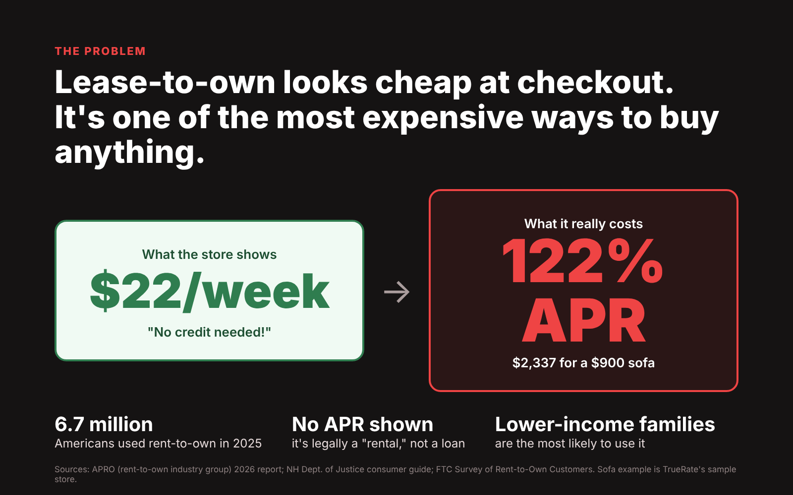
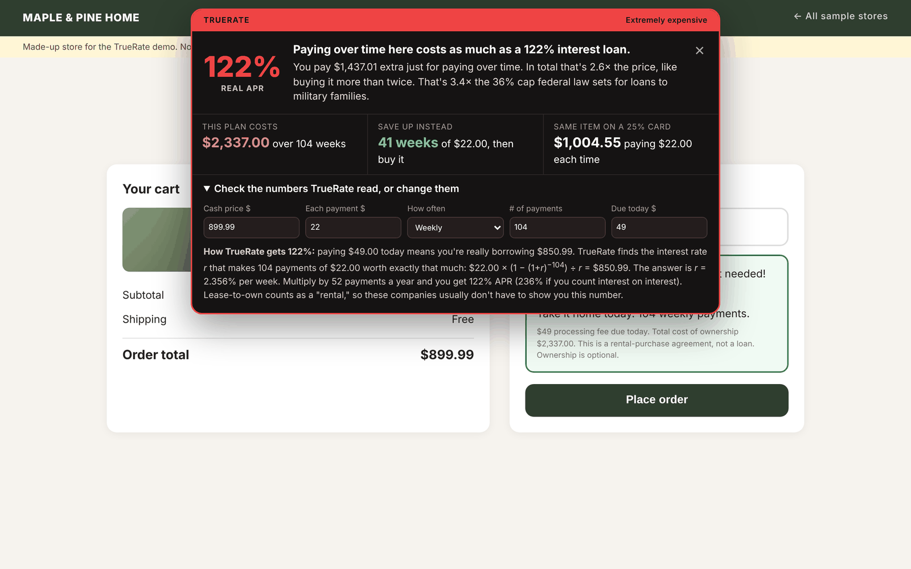
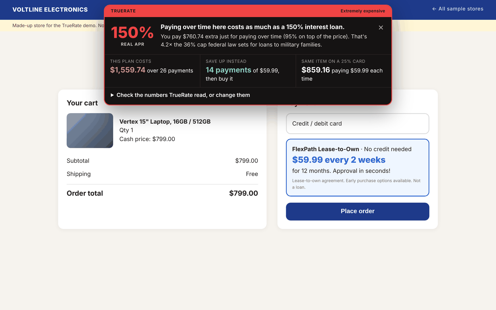
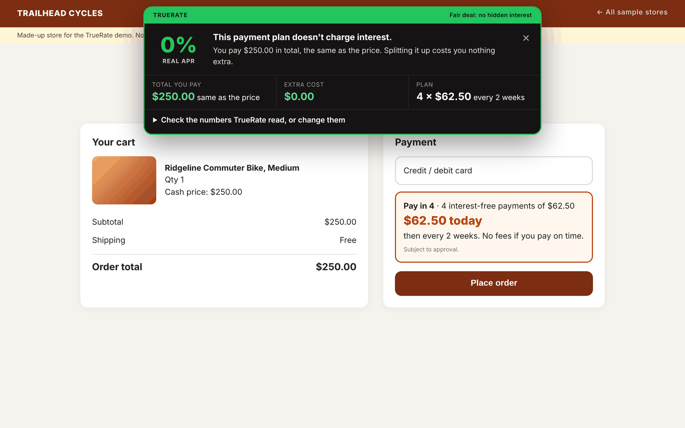
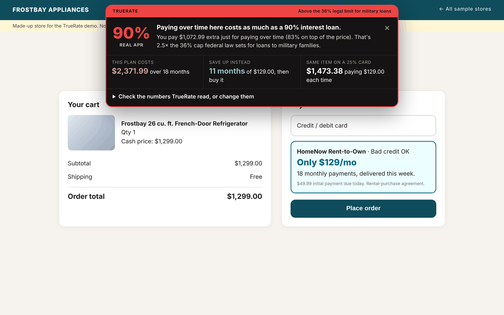
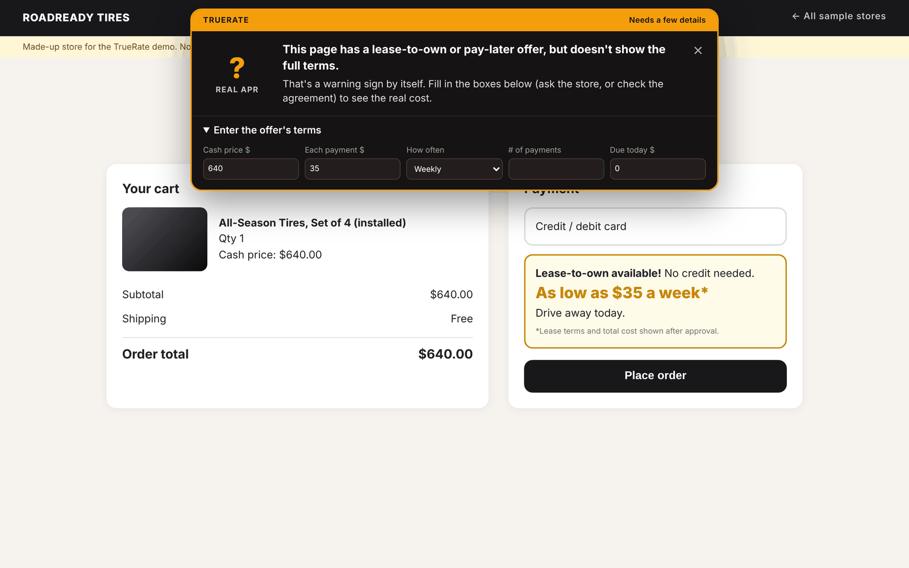
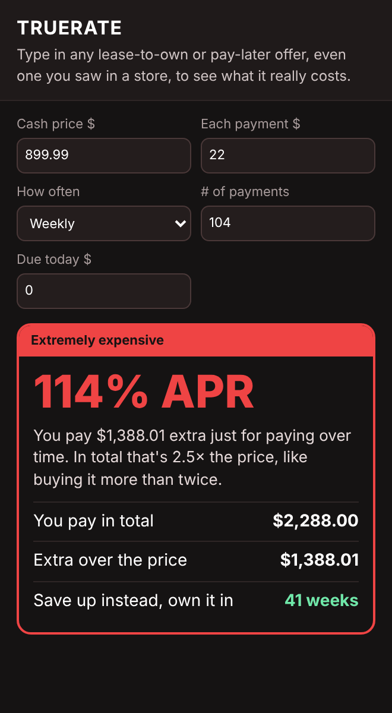
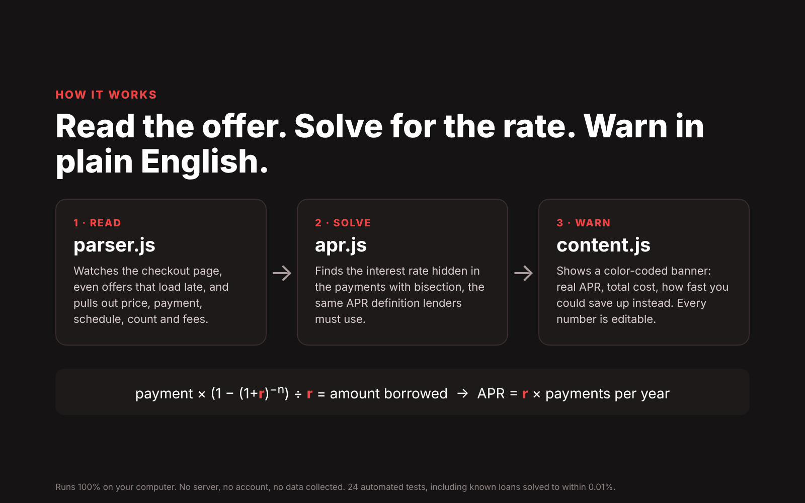

# TrueRate

**See the real interest rate hidden inside "lease-to-own" and "pay later" offers before you click buy.**

Built for **EvoHacks II** (theme: Projects for Social Good).

▶️ **[Watch the 2:50 demo video](https://youtu.be/KsizOH12GOI)**



---

## The problem in 30 seconds

- More and more online checkouts offer **lease-to-own**: *"No credit needed! Just $22/week."*
- Legally, lease-to-own counts as a **rental, not a loan**. That means the company usually **doesn't have to show an interest rate (APR)** the way a credit card or bank loan does.
- Without that number, people can't compare offers. A $900 sofa for $22 a week ends up costing **$2,337**, and that payment plan works out to a **122% APR**.
- The people who use these offers are mostly families with **lower incomes or no credit**, the people who can least afford to overpay.
- The lease companies have built browser extensions that **push** these offers at checkout. Nobody had built one that **pushes back**.

## What TrueRate does

TrueRate is a Chrome extension. When a checkout page shows a lease-to-own or pay-later offer, TrueRate:

1. **Reads the offer**: cash price, payment amount, how often you pay, number of payments, and any fee due today
2. **Works out the real APR**, the same way lenders are legally required to for loans
3. **Shows a color-coded banner** in plain English:
   - 🟢 **Fair**: no hidden interest
   - 🟡 **Costly**: charges interest, but under 36%
   - 🔴 **Above the legal limit**: over the 36% cap federal law sets for loans to military families
4. **Shows better options**: how many weeks it would take to save up and buy the item outright, and what the same purchase would cost on an ordinary 25% credit card
5. **Explains its math** step by step and **lets you fix** any number it read wrong

There's also a **pocket calculator** in the toolbar popup for offers you see in a physical store.

## Five sample stores, five kinds of offers

The `samples/` folder has five made-up checkout pages. Each one words its payment plan in a different way, the way real stores do. Each one also loads its offer about a second after the page, like real payment widgets.

| # | Sample store | How the offer is written | TrueRate's result |
|---|---|---|---|
| 1 | Maple & Pine Home, sofa | `$22.00/week`, `104 weekly payments`, `$49 fee due today` | 🔴 **122% APR**, $2,337 total for a $899.99 sofa |
| 2 | Voltline Electronics, laptop | `$59.99 every 2 weeks for 12 months` (TrueRate converts months into 26 payments) | 🔴 **150% APR**, $1,559.74 for a $799 laptop |
| 3 | Frostbay Appliances, fridge | `$129/mo`, `18 monthly payments`, `$49.99 initial payment` | 🔴 **90% APR**, $2,371.99 for a $1,299 fridge |
| 4 | Trailhead Cycles, bike | `4 interest-free payments of $62.50` | 🟢 **0%, fair deal.** TrueRate isn't against every payment plan, only the ones that hide their cost |
| 5 | RoadReady Tires, tires | `As low as $35 a week*` with the terms hidden | 🟡 Spots the offer, warns that hidden terms are a red flag, and asks you to fill in what's missing |

| Weekly lease, 122% | Every 2 weeks, 150% | Fair pay-in-4, 0% |
|---|---|---|
|  |  |  |

| Monthly lease, 90% | Hidden terms | Toolbar calculator |
|---|---|---|
|  |  |  |

## How it works



**Step 1: read (`parser.js`).** TrueRate reads the page's visible text and uses pattern matching to find the offer. It understands many ways stores write the same thing: `$22/week`, `$22 per week`, `$45 every 2 weeks`, `$129/mo`, `$89 monthly for 24 months`, `4 interest-free payments of $62.50`. If the number of payments is missing but the total is shown, it works the count out from the total. Checkout widgets often load late, so it keeps watching the page for changes.

**Step 2: solve (`apr.js`).** Lease companies show the payment, never the rate. TrueRate finds the interest rate *r* that makes all the payments worth exactly the money you're effectively borrowing:

```
payment × (1 − (1 + r)^−n) ÷ r  =  cash price − anything paid today
```

This equation can't be solved with simple algebra, so TrueRate uses **bisection**. The left side only goes down as *r* goes up, so TrueRate keeps cutting the search range in half until it has pinned *r* down. That always finds the one correct answer. The APR is *r* × payments per year, which is the nominal APR defined by the Truth in Lending Act. TrueRate also shows the rate with compounding.

**Step 3: warn (`content.js`).** The banner lives inside a **Shadow DOM**, so the store's styles can't break it and it can't break the store page. Every number is editable, and the math updates when you change one.

**A cautious estimate.** TrueRate assumes the first payment is made one period after you take the item home. Many leases actually take the first payment on day one, which makes the real rate even higher. So when TrueRate says 122%, the true cost is at least that.

## Tested

```
node tests/test.js
```

**24 automated tests, all passing.** They include:

- **Known loans:** a $1,000 loan at 12% and a $10,000 car loan at 6%. TrueRate recovers both rates to within 0.01%.
- **Every sample store:** the tests read each sample page and check that every term and the final APR come out right.
- **Different wording:** four more ways real stores phrase their offers.
- **Bad input:** missing numbers, or a fee bigger than the price, return "can't calculate" instead of a wrong answer.

## Install (2 minutes)

1. Download this repo (green **Code** button, then **Download ZIP**) and unzip it, or `git clone` it.
2. Open Chrome and go to `chrome://extensions`.
3. Turn on **Developer mode** (top right).
4. Click **Load unpacked** and choose the `TrueRate` folder.
5. **To try the sample stores:** click **Details** under TrueRate and turn on **Allow access to file URLs**. Then open `samples/index.html` in Chrome and pick a store.

## Privacy

TrueRate runs **entirely on your own computer**. There's no server, no account and no tracking. It never sends anything anywhere.

## Project files

| File | What it does |
|---|---|
| `manifest.json` | Tells Chrome what the extension is and where it runs |
| `parser.js` | Reads the offer terms from the page's text |
| `apr.js` | Math engine: APR solver, verdicts, savings plan, credit card comparison |
| `content.js` | Watches the page and draws the banner |
| `popup.html`, `popup.js` | Manual calculator in the toolbar |
| `samples/` | Five made-up checkout pages for testing and the demo |
| `tests/test.js` | Automated tests (run with Node.js) |

## What's next

- **AI backup reader:** when pattern matching can't find the terms, send the offer text to an AI model to pull them out
- **Firefox, Edge and Safari** versions
- **Spanish** version of the banner
- **Chrome Web Store** release so anyone can install it in one click

## Sources

- [NH Department of Justice](https://www.doj.nh.gov/consumer/sourcebook/rent-to-own.htm): rent-to-own contracts are not covered by the federal Truth in Lending Act's interest rate disclosure rules
- [Maryland Attorney General](https://www.marylandattorneygeneral.gov/CPD%20Documents/Tips-Publications/109.pdf): if rent-to-own dealers had to show an APR, rates would often be 120% to 150%
- [CFPB, Military Lending Act](https://www.consumerfinance.gov/consumer-tools/educator-tools/servicemembers/military-lending-act-mla/): the 36% cap on loans to service members
- [APRO 2026 industry report](https://www.rtohq.org/rent-to-own-industry-statistics): about 6.7 million Americans used rent-to-own in 2025
- [FTC Survey of Rent-to-Own Customers](https://www.ftc.gov/node/33300): customers are more likely to have lower incomes, have children and rent their homes

*All sample stores and lease companies in this project are made up. TrueRate is an educational tool, not financial advice.*
